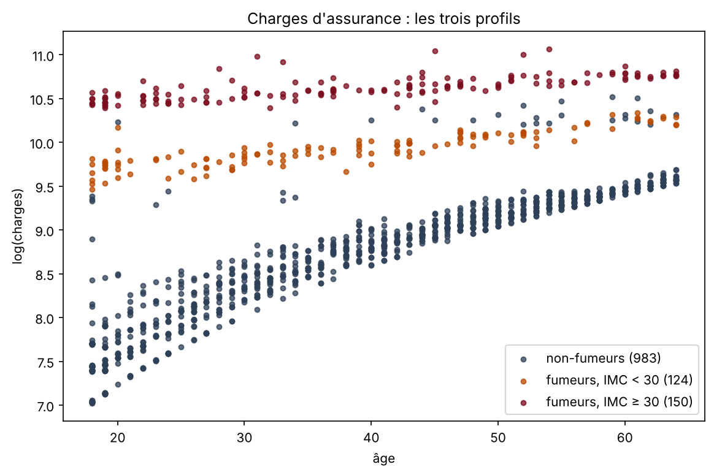
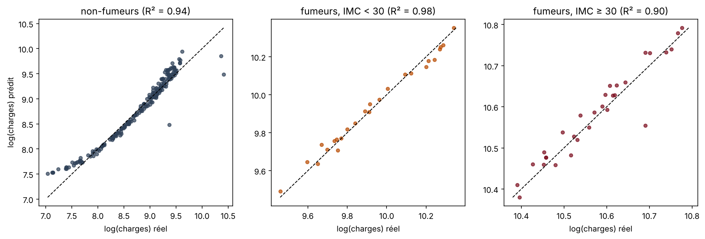

# Prédiction du prix d'une assurance santé

Comment l'âge, le sexe, l'IMC, le nombre d'enfants, le tabagisme et la région d'une personne déterminent-ils le prix de son assurance santé ? Analyse de 1 337 assurés américains, avec des régressions linéaires par morceaux.

<p align="center"></p>

## Objectif

Trouver une relation mathématique simple entre le profil d'un assuré et le montant annuel de son assurance. Données : [Medical Cost Personal Dataset](https://www.kaggle.com/datasets/mirichoi0218/insurance) (Kaggle). Projet du cours d'introduction au traitement de données de Polytech Nice Sophia.

## Démarche

- **Données** : 1 338 lignes, 7 variables, aucune valeur manquante, 1 doublon supprimé.
- **Exploration** : effet de chaque variable, en séparant fumeurs et non-fumeurs. Le tabac domine, et chez les fumeurs l'obésité (IMC ≥ 30) fait encore bondir le prix.
- **Variables créées** : sexe et tabac en 0 / 1, IMC en catégorie binaire (seuil de l'obésité à 30), région en 4 catégories, profil de risque qui croise tabac et obésité.
- **Régression double** : un modèle pour les fumeurs, un pour les non-fumeurs, avec une sélection des variables pas à pas sur le critère AIC.
- **Régression triple** : en logarithme, les charges forment trois nuages selon l'âge. On les sépare par des frontières tracées sur le graphique, on écarte le bruit situé entre les nuages (80 non-fumeurs, 6 % des données, inexpliqués par les variables disponibles) et on ajuste une régression par profil.

## Résultats

| Modèle | Variables | R² |
|---|---|---|
| Régression double : fumeurs | âge, IMC | 0,75 |
| Régression double : non-fumeurs | âge, enfants, sexe | 0,41 |
| Régression triple : non-fumeurs | toutes | 0,94 |
| Régression triple : fumeurs, IMC < 30 | toutes | 0,98 |
| Régression triple : fumeurs, IMC ≥ 30 | toutes | 0,90 |

La régression double est ajustée sur les charges en dollars, sur tous les assurés. La régression triple est ajustée sur le logarithme des charges et évaluée sur 20 % des assurés de chaque profil, mis de côté pendant l'apprentissage.

Les coefficients de la régression double se lisent en dollars : un fumeur paie environ 266 $ de plus par année d'âge et 1 440 $ de plus par point d'IMC.

<p align="center"></p>

## Outils

Python, pandas, scikit-learn, NumPy, Matplotlib

## Utilisation

Le code et les explications sont dans [`assurance_maladie.ipynb`](assurance_maladie.ipynb).

```bash
pip install -r requirements.txt
jupyter notebook assurance_maladie.ipynb
```
